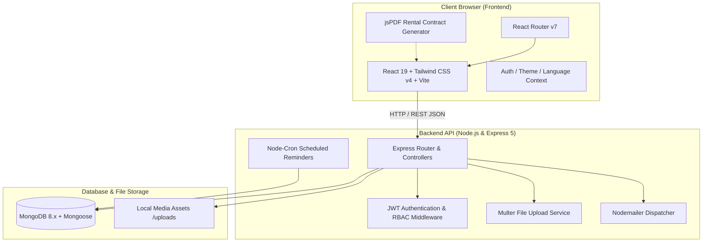
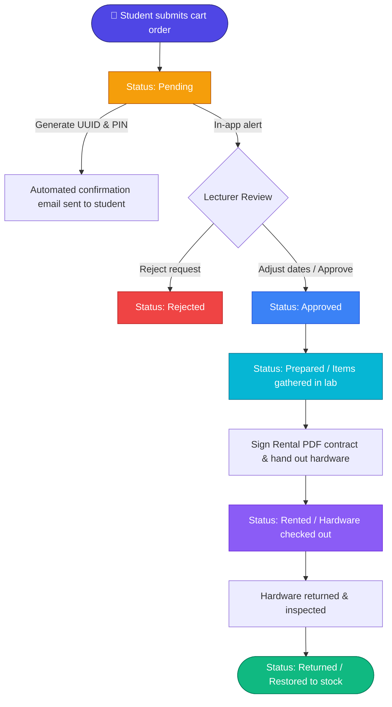

# 🔬 IoT Lab — Laboratory Inventory & Reservation System

[](https://react.dev/)
[](https://vitejs.dev/)
[](https://tailwindcss.com/)
[](https://nodejs.org/)
[](https://expressjs.com/)
[](https://www.mongodb.com/)
[](https://put.poznan.pl/)

> 🎓 **Laboratory Inventory Management & Hardware Reservation Platform**  
> *Developed as an Engineering Thesis at Poznań University of Technology (Politechnika Poznańska — PUT).*

---

## ⚡ Quick Start (3 Minutes)

Ready-to-run setup commands for Windows PowerShell (or Bash):

```powershell
# 1. Clone the repository
git clone https://github.com/kkamilll/IoTLab.git
cd IoTLab

# 2. Copy environment templates
Copy-Item .env.example .env
Copy-Item frontend/.env.example frontend/.env

# 3. Install backend dependencies and seed mock database
npm install
npm run db:seed    # Populates MongoDB with demo hardware, users & orders

# 4. Install frontend dependencies
cd frontend
npm install
cd ..
```

### Start Development Servers (2 Separate Terminals):

```powershell
# Terminal 1 — Backend API (port 3500, from IoTLab root directory):
npm run dev

# Terminal 2 — Frontend UI (port 5173, from frontend directory):
cd frontend
npm run dev
```

The application will be live immediately at:  
👉 **Client Interface:** [http://localhost:5173](http://localhost:5173)  
👉 **REST API Backend:** [http://localhost:3500](http://localhost:3500)

---

## 📑 Table of Contents

- [Overview](#-overview)
- [System Architecture](#-system-architecture)
- [Key Features](#-key-features)
- [Role-Based Access Control](#-role-based-access-control)
- [Order Lifecycle](#-order-lifecycle)
- [Tech Stack](#-tech-stack)
- [Project Structure & Important Architecture Notes](#-project-structure--architecture-notes)
- [Detailed Setup Guide](#-detailed-setup-guide)
  - [Prerequisites](#prerequisites)
  - [1. Backend & Root Configuration](#1-backend--root-configuration)
  - [2. Frontend Configuration](#2-frontend-configuration)
  - [3. Database Initialization & Seeding](#3-database-initialization--seeding)
  - [4. Running the Dev Servers](#4-running-the-dev-servers)
- [Test Credentials](#-test-credentials)
- [REST API Endpoints Reference](#-rest-api-endpoints-reference)
- [Application Routes](#-application-routes)
- [NPM Scripts Reference](#-npm-scripts-reference)
- [Troubleshooting & FAQ](#-troubleshooting--faq)
- [License & Academic Credits](#-license--academic-credits)

---

## 📖 Overview

**IoTLab** is an end-to-end web management platform designed to streamline the reservation, tracking, and auditing of laboratory equipment (microcontrollers such as Arduino, Raspberry Pi, ESP32, sensors, development kits, and discrete electronic components) in university environments.

- **For Students & Guests:** Intuitive hardware catalog with rich dynamic attributes, cart-based checkout without mandatory account registration, calendar date reservation (`DD/MM/YYYY`), real-time private order tracking via UUID & secret PIN, and interactive negotiation of pickup/return dates.
- **For Academic Staff & Administrators:** Multi-room inventory allocation, interactive visual timeline calendar preventing overlapping reservations, one-click PDF rental agreement generation, and automated in-app and email notifications.

---

## 🏗️ System Architecture



---

## ✨ Key Features

### 📦 Dynamic Inventory & Hardware Catalog
- **Custom Extra Fields:** Dynamic schema support per category or item (e.g., supply voltage, pinout specifications, communication protocols like I2C/SPI, package type).
- **Hierarchical Categories & Tags:** Nested category hierarchy with intuitive management and filtering.
- **Component Bundles & Bench Kits:** Aggregate discrete electronic parts and accessories into structured laboratory kits.
- **Live Search & Multi-Filter:** Instant client/server filtering by title, assigned room, lecturer, stock status, and custom tags.
- **Printable Inventory Audits:** One-click generation of printable equipment inventory audit sheets in PDF format.

### 🛒 Seamless Guest Checkout & Tracking
- **Account-Free Requests:** Students and visiting researchers submit hardware checkout requests directly via a streamlined 2-step cart.
- **Day-Based Date Reservations:** Clean calendar day selection (`DD/MM/YYYY`) without confusing hourly constraints, supporting single-day and multi-day bookings.
- **Bot Protection:** Form verification using SVG Captchas and optional Google reCAPTCHA v2.
- **Private Order Tracker:** Every order is issued a cryptographically secure UUID and a private PIN access code delivered via email.
- **Interactive Schedule Negotiation:** Students can review, approve, or decline alternative pickup and return dates proposed by the lecturer.

### 📅 Order Management & Interactive Calendar
- **Interactive Timeline Calendar:** Visual schedule built with `React Big Calendar` displaying hardware occupancy across lab rooms and date windows.
- **Real-Time Stock Forecasting:** Algorithmic calculation of overlapping reservation intervals to guarantee zero double-booking.
- **Automated Rental Agreements (PDF):** Automatically generates legally binding rental contracts populated with student details, asset serial numbers, terms of service, and signature sections.
- **Safe State Transitions:** Enforced confirmation dialogs for critical workflow steps (Approve, Prepare, Rent, Return, Reject).

### 🔔 Notifications & Automated Communication
- **In-App Notification Hub:** Real-time alert notifications for faculty members whenever equipment in their assigned rooms is requested.
- **Automated Email Dispatch:** Modular HTML email dispatch (`Nodemailer`) supporting dynamic runtime placeholders (`${CustomerName}`, `${orderId}`, `${orderLink}`, `${orderPassword}`, `${startDate}`, `${endDate}`).
- **Template Management:** Built-in email template editor allowing administrators to customize layouts or revert to production defaults.

### 🎨 User Experience (UX/UI)
- **Dark & Light Mode:** Native responsive theming powered by TailwindCSS v4 variables.
- **Internationalization (i18n):** Instant on-the-fly language switching between English (EN) and Polish (PL).
- **Public Announcement Board:** Administrator bulletin board for broadcasting lab maintenance, opening hours, and news directly on the home page.

---

## 👥 Role-Based Access Control

| Permission / Action | Student / Guest | Lecturer (Room Supervisor) | Administrator |
|:---|:---:|:---:|:---:|
| Browse public equipment catalog | ✅ | ✅ | ✅ |
| Submit reservation request via cart | ✅ | ✅ | ✅ |
| Track private order via UUID & PIN | ✅ | ✅ | ✅ |
| Manage assigned room inventory & items | ❌ | ✅ | ✅ |
| Receive in-app reservation alerts | ❌ | ✅ | ✅ |
| Approve / Prepare / Hand out / Return orders | ❌ | ✅ | ✅ |
| Generate Rental Agreement PDFs | ❌ | ✅ | ✅ |
| View reservation timeline calendar | ❌ | ✅ | ✅ |
| Manage user accounts & room assignments | ❌ | ❌ | ✅ |
| Edit dynamic categories & email templates | ❌ | ❌ | ✅ |
| Publish announcements on home page | ❌ | ❌ | ✅ |

---

## 🔄 Order Lifecycle



| Status | Actor | Description |
|:---|:---|:---|
| **Pending** | Student / System | Cart order submitted; automated email dispatched containing order UUID and secret PIN. |
| **Approved** | Lecturer | Lab supervisor verifies component availability and accepts or reschedules reservation dates. |
| **Prepared** | Lecturer / Staff | Hardware items are physically gathered, tested, and marked ready for student pickup. |
| **Rented** | Student & Lecturer | Rental Agreement PDF is printed/signed; equipment is officially checked out of the lab. |
| **Returned** | Lecturer | Hardware is inspected for physical defects and returned; stock counts restore automatically. |
| **Rejected** | Lecturer | Request declined if components are unavailable, broken, or in conflict with class schedules. |

---

## 💻 Tech Stack

### Frontend
- **Framework:** [React 19](https://react.dev/) + [Vite 6](https://vitejs.dev/)
- **Styling:** [TailwindCSS v4](https://tailwindcss.com/) + CSS Design Tokens
- **UI Components & Icons:** [Material UI (MUI)](https://mui.com/) (`@mui/material`, `@mui/x-date-pickers`), [Lucide React](https://lucide.dev/), [React Icons](https://react-icons.github.io/react-icons/)
- **Routing:** [React Router v7](https://reactrouter.com/)
- **Calendar & Dates:** [React Big Calendar](https://jquense.github.io/react-big-calendar/) + [Date-fns](https://date-fns.org/)
- **Drag & Drop:** `@dnd-kit/core`, `@dnd-kit/sortable`
- **Client-Side PDF Engine:** [jsPDF](https://github.com/parallax/jsPDF) + `jspdf-autotable`
- **Charts:** [Recharts](https://recharts.org/)

### Backend
- **Runtime:** [Node.js](https://nodejs.org/) (ES Modules)
- **API Framework:** [Express 5](https://expressjs.com/)
- **Database:** [MongoDB](https://www.mongodb.com/) with [Mongoose 8](https://mongoosejs.com/) ODM
- **Authentication:** JSON Web Tokens (`jsonwebtoken`) + `bcrypt`
- **Email Delivery:** [Nodemailer](https://nodemailer.com/) (SMTP / Gmail App Passwords)
- **File Uploads:** `multer`
- **Scheduled Tasks:** `node-cron`
- **Logging & Security:** `morgan`, `cors`, `svg-captcha`

---

## 📁 Project Structure & Architecture Notes

> [!IMPORTANT]
> **Repository Architecture Overview:**  
> - **Root Directory (`/`):** Manages configuration files, database migration scripts, and the **Backend API dependencies** (`package.json`).
> - **Frontend Directory (`/frontend`):** Houses the standalone React + Vite single-page application with its own dedicated `package.json`.
> - **Backend Directory (`/backend`):** Contains the Express server controllers, routes, Mongoose models, and services executed by the root package.

```plaintext
IoTLab/
├── .env                      # Backend environment variables (PORT, MONGO_URI, JWT_SECRET, SMTP)
├── .env.example              # Backend environment template
├── package.json              # BACKEND dependencies and database scripts
├── README.md                 # Complete project documentation
│
├── backend/                  # Server-side source code (Node.js & Express)
│   ├── config/               # Database connection setup (db.js)
│   ├── controllers/          # Business logic (Order, Product, User, Category, etc.)
│   ├── errors/               # Custom HTTP error hierarchy
│   ├── middleware/           # JWT authentication, RBAC authorization, file upload
│   ├── models/               # Mongoose schemas (User, Product, Order, Template, etc.)
│   ├── routes/               # Express REST API route endpoints
│   ├── services/             # Background services (mail dispatch, notifications)
│   ├── utils/                # Mock data generators, PDF templates, cron routines
│   ├── init.js               # Clean production database reset script
│   ├── seed.js               # Development demo data seeding script
│   └── server.js             # Express API entry point (port 3500)
│
├── frontend/                 # Client-side source code (React + Vite)
│   ├── .env                  # Frontend environment variables (VITE_API_IP, VITE_API_PORT, VITE_API_BASE_URL)
│   ├── .env.example          # Frontend environment template
│   ├── src/
│   │   ├── api/              # Axios instance configured with auto JWT header injection
│   │   ├── components/       # Reusable UI modules (Orders, Products, Cart, Auth, Layout)
│   │   ├── context/          # State providers (Auth, Language, Theme, Toast)
│   │   ├── pages/            # Application views (Dashboard, Orders, Catalog, etc.)
│   │   ├── utils/            # PDF generators, i18n localization dicts, route guards
│   │   ├── App.jsx           # Main React Router v7 configuration
│   │   └── main.jsx          # React DOM entry point
│   ├── public/               # Static assets & public icons
│   └── package.json          # FRONTEND dependencies
│
└── uploads/                  # Uploaded equipment photos and documentation files
```

---

## 🚀 Detailed Setup Guide

### Prerequisites
1. **Node.js**: Version `v18.0.0` or higher ([Download Node.js](https://nodejs.org/)).
2. **MongoDB**: Local MongoDB instance running on port `27017` (e.g. as a Windows Service) or a [MongoDB Atlas](https://www.mongodb.com/cloud/atlas) cluster.
3. **Package Manager**: `npm` (bundled with Node.js).

---

### 1. Backend & Root Configuration

1. Open your terminal in the root `IoTLab` directory:
   ```bash
   cd IoTLab
   ```
2. Install backend dependencies:
   ```bash
   npm install
   ```
3. Create the root `.env` file (or copy from `.env.example`):
   ```env
   # Express Server Port
   PORT=3500

   # MongoDB Connection String
   MONGO_URI=mongodb://127.0.0.1:27017/iotlab_db

   # JWT Secret Key for token signing
   JWT_SECRET=your_secure_jwt_secret_key_2026

   # Email Delivery Configuration (Nodemailer)
   SMTP_HOST=smtp.gmail.com
   SMTP_SERVICE=gmail
   SMTP_PORT=587
   SMTP_MAIL=your_email@gmail.com
   SMTP_PASSWORD=your_gmail_app_password
   ```

---

### 2. Frontend Configuration

1. Navigate to the `frontend` directory:
   ```bash
   cd frontend
   ```
2. Install frontend dependencies:
   ```bash
   npm install
   ```
3. Create the `frontend/.env` file (or copy from `frontend/.env.example`):
   ```env
   VITE_API_IP=http://localhost:
   VITE_API_PORT=3500
   VITE_API_POSTFIX=
   VITE_API_BASE_URL=http://localhost:3500
   ```
4. Return to the root folder:
   ```bash
   cd ..
   ```

---

### 3. Database Initialization & Seeding

Choose one of the following commands (executed from the root `IoTLab` directory):

#### Option A: Seed Mock Data (Recommended for Development & Testing)
Populates the database with 4 user accounts, 6 hardware categories, 11 lab components, 5 test orders across all lifecycle states, and default email templates:
```bash
npm run db:seed
```

#### Option B: Clean Production Initialization
Clears existing collections and initializes only the Administrator account (`admin@gmail.com` / `admin`) and system email templates:
```bash
npm run db:init
```

---

### 4. Running the Dev Servers

Run both servers concurrently in two separate terminal windows:

#### Terminal 1 — Backend API:
```bash
npm run dev
```
> Starts nodemon watching `backend/server.js` on:  
> **http://localhost:3500**

#### Terminal 2 — Frontend Client:
```bash
cd frontend
npm run dev
```
> Starts the Vite development server on:  
> **http://localhost:5173**

---

## 🔑 Test Credentials

After running `npm run db:seed`, the following accounts are pre-configured:

| System Role | Email Address | Password | Assigned Lab Rooms |
|:---|:---|:---|:---|
| **Administrator** | `admin@gmail.com` | `admin` | Room 101, Room 102 *(Full System Access)* |
| **Lecturer 1** | `lecturer1@gmail.com` | `password` | Equipment assigned to Lecturer 1's room |
| **Lecturer 2** | `lecturer2@gmail.com` | `password` | Equipment assigned to Lecturer 2's room |
| **Lecturer 3** | `lecturer3@gmail.com` | `password` | Equipment assigned to Lecturer 3's room |

---

## 📡 REST API Endpoints Reference

All endpoints are hosted at `http://localhost:3500`.

| Category | HTTP Method | Endpoint | Required Role | Description |
|:---|:---:|:---|:---:|:---|
| **Auth** | `POST` | `/auth/login` | Public | Authenticates credentials and returns JWT session token |
| | `POST` | `/auth/forgot-password` | Public | Generates and sends a 15-minute password reset verification code |
| | `POST` | `/auth/reset-password` | Public | Resets user password using the verification code |
| **Orders** | `POST` | `/orders/create` | Public | Submits a new guest cart reservation request |
| | `GET` | `/orders/customerOrder/:orderUUID`| Public | Fetches order summary for student tracking |
| | `POST` | `/orders/customerUpdate/:orderId` | Public (PIN) | Student accepts or declines proposed reservation dates |
| | `GET` | `/orders` | Lecturer / Admin | Paginated list of reservations with multi-filtering |
| | `PUT` | `/orders/updateOrder/:orderId` | Lecturer / Admin | Updates order statuses and assigned reservation dates |
| | `GET` | `/orders/stats` | Lecturer / Admin | Returns aggregated reservation analytics |
| | `GET` | `/orders/statuses` | Lecturer / Admin | Returns all valid order status definitions |
| | `POST` | `/orders/download-pdf` | Lecturer / Admin | Generates and downloads rental agreement PDF |
| | `DELETE`| `/orders/:orderId` | Lecturer / Admin | Permanently deletes an order record |
| **Products** | `GET` | `/products/public` | Public | Retrieves all active equipment available for guest reservation |
| | `GET` | `/products/publicId/:productId` | Public | Retrieves public details for a single product |
| | `POST` | `/products/available` | Public | Calculates real-time available stock across given reservation dates |
| | `GET` | `/products/private` | Lecturer / Admin | Full inventory view filtered by room assignment |
| | `GET` | `/products/privateId/:productId` | Lecturer / Admin | Full product specifications including private attachments |
| | `POST` | `/products/create` | Lecturer / Admin | Adds a new piece of equipment (with image and attachment uploads) |
| | `PUT` | `/products/:productId` | Lecturer / Admin | Updates hardware specifications and stock counts |
| | `DELETE`| `/products/:productId` | Lecturer / Admin | Soft/hard deletes a product from the database |
| | `POST` | `/products/stockStatus` | Lecturer / Admin | Detailed stock breakdown (reserved vs rented vs in-demand) |
| | `DELETE`| `/products/extraField/:key` | Lecturer / Admin | Removes a dynamic extra attribute field across all products |
| **Categories**| `GET` | `/categories/public` | Public | Fetches category tree for public navigation |
| | `GET` | `/categories/private` | Lecturer / Admin | Fetches category hierarchy for management |
| | `POST` | `/categories/create` | Administrator | Adds a new category |
| | `PATCH` | `/categories/:categoryId` | Administrator | Updates category name and details |
| | `DELETE`| `/categories/:categoryId` | Administrator | Deletes a category |
| **Users** | `GET` | `/users/profile` | Authenticated | Retrieves current user profile data |
| | `PUT` | `/users/profile` | Authenticated | Updates current user profile details and password |
| | `GET` | `/users` | Administrator | Retrieves faculty member list and room allocations |
| | `POST` | `/users/create` | Administrator | Registers a new lecturer or administrator account |
| | `PUT` | `/users/:userId` | Administrator | Updates user credentials and room assignments |
| | `DELETE`| `/users/:userId` | Administrator | Deletes a user account |
| **Notifications** | `GET` | `/notifications` | Lecturer / Admin | Retrieves in-app alerts for pending orders and updates |
| | `PATCH` | `/notifications/read-all` | Lecturer / Admin | Marks all user notifications as read |
| | `PATCH` | `/notifications/:id/read` | Lecturer / Admin | Marks a single notification as read |
| | `DELETE`| `/notifications` | Lecturer / Admin | Clears all user notifications |
| **Templates** | `GET` | `/templates` | Administrator | Retrieves all customizable HTML email templates |
| | `GET` | `/templates/names` | Administrator | Retrieves template identifier names |
| | `GET` | `/templates/:templateId` | Administrator | Fetches single template content |
| | `POST` | `/templates/create` | Administrator | Creates a new email template |
| | `PUT` | `/templates/update/:templateId` | Administrator | Saves modifications to email template content |
| | `DELETE`| `/templates/delete/:templateId` | Administrator | Deletes a custom email template |
| **Notes** | `GET` | `/notes` | Public | Fetches announcements displayed on the landing page |
| | `POST` | `/notes/create` | Lecturer / Admin | Publishes a new bulletin announcement |
| | `PUT` | `/notes/:noteId` | Lecturer / Admin | Updates announcement content |
| | `DELETE`| `/notes/:noteId` | Lecturer / Admin | Removes an announcement |
| **Materials** | `GET` | `/materials` | Public | Fetches landing page hero carousel banner slides |
| | `POST` | `/materials` | Administrator | Uploads new slide media |
| | `PATCH` | `/materials/reorder` | Administrator | Reorders banner slide display order |
| | `PATCH` | `/materials/:id` | Administrator | Updates banner slide link |
| | `DELETE`| `/materials/:id` | Administrator | Deletes a banner slide |
| **Components** | `GET` | `/components` | Public | Lists laboratory component kits and bundles |
| | `GET` | `/components/:collectionId`| Public | Fetches component bundle details and files |
| | `POST` | `/components/create` | Administrator | Creates a component bundle collection |
| | `POST` | `/components/:collectionId/links` | Administrator | Adds external documentation link to a bundle |
| | `POST` | `/components/:collectionId/files` | Administrator | Attaches reference files to a bundle |

---

## 🗺️ Application Routes

### Public Zone (Students & Guests)
- `/` — Landing page featuring lab news, announcements, carousel banners, and quick order tracking.
- `/mainguest` — Student portal with category cards and hardware navigation.
- `/guest-products/:menuCategory?` — Searchable hardware catalog with dynamic attribute filters and cart drawer.
- `/cart` — Two-step guest checkout, calendar date selection (`DD/MM/YYYY`), and verification.
- `/orderPreview/:orderUUID` — Dedicated order tracking page (requires private PIN validation).
- `/components/:collectionId` — Public view of component kits, bundle parts, and documentation.
- `/preview` — Equipment specification preview modal.
- `/forgot-password` — Password reset workflow for faculty members.
- `/login` — Faculty and administrative authentication gateway.

### Administrative Zone (`/admin-dashboard`)
- `/admin-dashboard` — Main metrics overview, occupancy charts, and activity log.
- `/admin-dashboard/orders` — Order status management table and interactive reservation calendar.
- `/admin-dashboard/products` — Equipment catalog management, stock control, and dynamic field configuration.
- `/admin-dashboard/profile` — Faculty profile settings, contact info, and password change.
- `/admin-dashboard/notes` — Laboratory announcements and bulletin board management.
- `/admin-dashboard/notifications` — In-app notification center for pending requests and status changes.
- `/admin-dashboard/categories` *(Admin Only)* — Hierarchical category and tag management.
- `/admin-dashboard/users` *(Admin Only)* — Staff user accounts and laboratory room assignments.
- `/admin-dashboard/materials` *(Admin Only)* — Hero banner slides and media carousel management.
- `/admin-dashboard/components` *(Admin Only)* — Component kits and laboratory bundle management.
- `/admin-dashboard/templates` *(Admin Only)* — Email notification template visual editor.

---

## 📜 NPM Scripts Reference

### Root Directory (`/`):
| Script | Command | Purpose |
|:---|:---|:---|
| `npm run dev` | `nodemon backend/server.js` | Launches the Express API server with automatic hot-reload. |
| `npm run db:seed` | `node backend/seed.js` | Clears and populates MongoDB with complete mock data. |
| `npm run db:init` | `node backend/init.js` | Resets MongoDB with only default admin and email templates. |
| `npm run db:start` | `mongod --dbpath .mongo_data` | Manually starts local Windows MongoDB daemon instance. |

### Frontend Directory (`/frontend`):
| Script | Command | Purpose |
|:---|:---|:---|
| `npm run dev` | `vite --host` | Starts the Vite development web server (`http://localhost:5173`). |
| `npm run build` | `vite build` | Compiles optimized production bundle into `dist/`. |
| `npm run preview` | `vite preview` | Locally serves and previews the production build. |
| `npm run lint` | `eslint .` | Runs ESLint analysis across client codebase. |

---

## ❓ Troubleshooting & FAQ

<details>
<summary><b>1. Products fail to load on the home page or catalog?</b></summary>

- **Issue 1:** Missing `frontend/.env` file.  
  *Fix:* Copy `frontend/.env.example` to `frontend/.env` and verify `VITE_API_PORT=3500`.
- **Issue 2:** The MongoDB database has not been populated.  
  *Fix:* Execute `npm run db:seed` in the root project folder.
</details>

<details>
<summary><b>2. Error: Connection failed / MongoServerError: connect ECONNREFUSED?</b></summary>

- Ensure your MongoDB server is active.
- On Windows, verify the service status with PowerShell:  
  `Get-Service -Name MongoDB`
- If it is stopped, start it via:  
  `Start-Service -Name MongoDB`
- Alternatively, start a local data directory instance with `npm run db:start`.
</details>

<details>
<summary><b>3. Error: 'vite' is not recognized as an internal or external command?</b></summary>

- This occurs when client dependencies have not been installed.
- Navigate to the frontend directory and run:  
  `cd frontend && npm install`
</details>

<details>
<summary><b>4. How do I enable real outbound emails for reservations?</b></summary>

- In the root `.env` file, supply your SMTP credentials (such as Google Workspace or Gmail):
  - `SMTP_MAIL=your_email@gmail.com`
  - `SMTP_PASSWORD=your_gmail_app_password` *(Generated in Google Account: Security -> 2-Step Verification -> App Passwords).*
</details>

---

## 📄 License & Academic Credits

Developed as an **Engineering Thesis** for academic and laboratory purposes at **Poznań University of Technology** (*Politechnika Poznańska — PUT*).  
All rights reserved for educational and research use.
