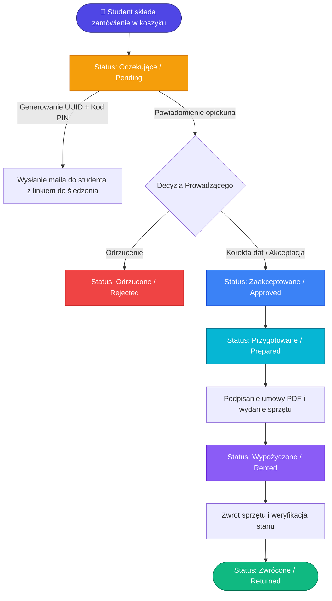

<div align="center">

# 🔬 System Inwentaryzacji i Rezerwacji Sprzętu — IoT Lab

**Nowoczesna, kompleksowa platforma webowa wspomagająca zarządzanie zasobami laboratoryjnymi, dynamiczną inwentaryzację oraz pełny obieg rezerwacji i wypożyczeń sprzętu badawczo-dydaktycznego.**

[](https://react.dev/)
[](https://vitejs.dev/)
[](https://tailwindcss.com/)
[](https://nodejs.org/)
[](https://expressjs.com/)
[](https://www.mongodb.com/)
[](https://put.poznan.pl/)

---

[📖 O projekcie](#o-projekcie) •
[✨ Funkcjonalności](#kluczowe-funkcjonalności) •
[👥 Role w systemie](#role-w-systemie) •
[🔄 Obieg zamówień](#cykl-życia-zamówienia) •
[💻 Stos technologiczny](#stos-technologiczny) •
[📁 Struktura projektu](#struktura-katalogów) •
[🚀 Szybki start](#instalacja-i-uruchomienie) •
[🔑 Konta testowe](#konta-testowe) •
[🗺️ Trasy aplikacji](#wykaz-tras-routing)

---

</div>

## 📖 O projekcie

**System Inwentaryzacyjny IoT Lab** powstał w celu zautomatyzowania i usprawnienia procesów ewidencji, katalogowania oraz wypożyczania komponentów i aparatury pomiarowo-laboratoryjnej dla studentów, doktorantów oraz pracowników naukowo-dydaktycznych.

Aplikacja eliminuje papierowy obieg dokumentów i chaotyczną komunikację mailową, oferując:
- Przejrzysty katalog sprzętu dostępny dla każdego bez konieczności rejestracji konta,
- Bezpieczny mechanizm rezerwacji z kodem PIN i unikalnym identyfikatorem UUID,
- Dedykowany panel opiekuna sprzętu i administratora z kalendarzem rezerwacji,
- Automatyczne powiadomienia e-mail oraz generowanie umów wypożyczenia w formacie PDF.

---

## ✨ Kluczowe funkcjonalności

### 📦 Ewidencja i Magazyn Sprzętu
- **Elastyczny schemat danych (Custom Extra Fields)** – możliwość definiowania dowolnych atrybutów technicznych (np. napięcie, interfejs, obudowa) per kategoria/produkt.
- **Wielopoziomowe kategorie i tagi** – dynamiczne drzewo kategorii z obsługą przeciągania elementów (*drag and drop*).
- **Komponenty i zestawy** – grupowanie drobnych elementów powiązanych ze stanowiskami laboratoryjnymi.
- **Filtrowanie i wyszukiwanie na żywo** – natychmiastowe wyszukiwanie wg nazwy, sali, opiekuna, tagów oraz dostępności magazynowej.
- **Raporty PDF** – generowanie zestawień inwentaryzacyjnych magazynu do plików PDF.

### 🛒 Rezerwacje i Koszyk (Dla Studentów / Gości)
- **Brak wymogu zakładania konta** – szybki 2-etapowy proces składania zamówienia przez formularz koszyka.
- **Zabezpieczenie Captcha** – ochrona przed automatycznym spamowaniem rezerwacji (Google reCAPTCHA v2 / SVG captcha).
- **Prywatny kod śledzenia (UUID + Secret Code)** – po złożeniu zamówienia student otrzymuje unikalny link oraz kod dostępu do podglądu zamówienia.
- **Akceptacja terminów przez studenta** – możliwość potwierdzenia lub odrzucenia skorygowanych przez prowadzącego dat odbioru.

### 📅 Zarządzanie Zamówieniami i Kalendarz
- **Interaktywny kalendarz rezerwacji** – wizualizacja terminów wypożyczeń na osi czasu (`React Big Calendar`) z filtrowaniem po statusach i salach.
- **Dialogi potwierdzenia akcji** – zabezpieczenie przed przypadkową zmianą statusu (zatwierdzenie, przygotowanie, wydanie, zwrot, odrzucenie).
- **Generowanie Umowy Wypożyczenia (PDF)** – automatyczne wygenerowanie gotowego do druku dokumentu z danymi studenta, wykazem sprzętu, regulaminem i miejscem na podpisy.
- **Kalkulacja dostępności sprzętu** – dynamiczne zliczanie zapotrzebowania w danym przedziale czasowym.

### 🔔 Komunikacja i Powiadomienia
- **Centrum powiadomień w aplikacji (Notification Hub)** – prowadzący otrzymują natychmiastowe powiadomienia o zapotrzebowaniu na przedmioty przypisane do ich sal.
- **Automatyczne wiadomości e-mail** – moduł `Nodemailer` wysyłający wiadomości z dynamicznie renderowanymi szablonami (nowe zamówienie, zmiana statusu, reset hasła).
- **Edytor szablonów e-mail** – administrator ma możliwość edycji treści szablonów bezpośrednio z poziomu panelu.

### 🎨 Doświadczenie Użytkownika (UX/UI)
- **Ciemny motyw (Dark Mode)** – pełna obsługa trybu jasnego i ciemnego ze spójną paletą kolorów TailwindCSS.
- **Wielojęzyczność (i18n)** – natychmiastowe przełączanie języka interfejsu (Polski / Angielski).
- **Tablica ogłoszeń** – możliwość publikacji komunikatów dla studentów na stronie powitalnej.

---

## 👥 Role w systemie

| Uprawnienie / Funkcja | Gość / Student | Prowadzący (Lecturer) | Administrator |
|:---|:---:|:---:|:---:|
| Przeglądanie katalogu i parametrów sprzętu | ✅ | ✅ | ✅ |
| Składanie zamówień przez koszyk | ✅ | ✅ | ✅ |
| Śledzenie zamówienia dedykowanym kodem | ✅ | ✅ | ✅ |
| Zarządzanie własnym sprzętem i salami | ❌ | ✅ | ✅ |
| Otrzymywanie powiadomień o rezerwacjach | ❌ | ✅ | ✅ |
| Zmiana statusów zamówień i generowanie umów PDF | ❌ | ✅ | ✅ |
| Widok kalendarza rezerwacji | ❌ | ✅ | ✅ |
| Zarządzanie użytkownikami i uprawnieniami | ❌ | ❌ | ✅ |
| Tworzenie kategorii, tagów i szablonów e-mail | ❌ | ❌ | ✅ |
| Publikacja ogłoszeń na stronie głównej | ❌ | ❌ | ✅ |

---

## 🔄 Cykl życia zamówienia



---

## 💻 Stos technologiczny

### Frontend
- **Biblioteka bazowa:** [React 19](https://react.dev/) + [Vite 6](https://vitejs.dev/)
- **Stylowanie:** [TailwindCSS v4](https://tailwindcss.com/) + CSS Variables
- **Komponenty i ikony:** [Material UI (MUI)](https://mui.com/), [Lucide React](https://lucide.dev/), [React Icons](https://react-icons.github.io/react-icons/)
- **Routing:** [React Router v7](https://reactrouter.com/)
- **Kalendarz:** [React Big Calendar](https://jquense.github.io/react-big-calendar/) + [Date-fns](https://date-fns.org/)
- **Przeciąganie elementów (DnD):** `@dnd-kit/core`, `@dnd-kit/sortable`
- **Generowanie dokumentów PDF:** [jsPDF](https://github.com/parallax/jsPDF) + `jspdf-autotable`
- **Wykresy i analityka:** [Recharts](https://recharts.org/)

### Backend
- **Środowisko uruchomieniowe:** [Node.js](https://nodejs.org/) (ES Modules)
- **Framework API:** [Express 5](https://expressjs.com/)
- **Baza danych:** [MongoDB](https://www.mongodb.com/) z ODM [Mongoose 8](https://mongoosejs.com/)
- **Uwierzytelnianie i sesja:** JSON Web Tokens (`jsonwebtoken`) + `bcrypt`
- **Poczta e-mail:** [Nodemailer](https://nodemailer.com/) (obsługa Gmail SMTP / custom host)
- **Obsługa plików i multimediów:** `multer`
- **Zadania cykliczne (Cron):** `node-cron`
- **Logowanie i bezpieczeństwo:** `morgan`, `cors`, `svg-captcha`

---

## 📁 Struktura katalogów

```plaintext
IoTLab/
├── backend/                  # Warstwa serwerowa (Node.js & Express)
│   ├── config/               # Połączenie z bazą danych (MongoDB)
│   ├── controllers/          # Logika biznesowa (Order, Product, User, Category itp.)
│   ├── middleware/           # Autoryzacja JWT, walidacja ról, upload plików
│   ├── models/               # Schematy Mongoose (User, Product, Order, Template, etc.)
│   ├── routes/               # Definicje endpointów REST API
│   ├── services/             # Serwisy pomocnicze (np. wysyłka maili)
│   ├── utils/                # Generatory danych testowych, mocki
│   ├── uploads/              # Przechowalnia przesłanych zdjęć sprzętu
│   ├── init.js               # Skrypt czyszczenia i inicjalizacji bazy produkcyjnej
│   ├── seed.js               # Skrypt zasilenia danymi demonstracyjnymi
│   └── server.js             # Główny punkt startowy serwera Express
│
├── frontend/                 # Aplikacja kliencka (React + Vite)
│   ├── src/
│   │   ├── components/       # Komponenty UI (Orders, Products, Categories, Cart, Auth)
│   │   ├── context/          # Konteksty React (Język, Motyw Dark/Light, Powiadomienia)
│   │   ├── pages/            # Widoki aplikacji (Dashboard, Orders, Products, Cart itp.)
│   │   ├── utils/            # Generatory PDF, translacje i18n, guardy routingu
│   │   ├── App.jsx           # Główny komponent z definicją tras
│   │   └── main.jsx          # Punkt wejścia React
│   ├── public/               # Zasoby statyczne
│   └── package.json          # Zależności frontendu
│
├── .env                      # Zmienne środowiskowe (niecommitowane)
├── package.json              # Główne skrypty i zależności backendu
└── README.md                 # Główna dokumentacja projektu
```

---

## 🚀 Instalacja i uruchomienie

### Wymagania wstępne
- **Node.js** w wersji `v18.0.0` lub nowszej
- **npm** (lub pnpm / yarn)
- Działająca instancja **MongoDB** (lokalnie lub w chmurze [MongoDB Atlas](https://www.mongodb.com/cloud/atlas))

---

### Krok 1: Klonowanie repozytorium
```bash
git clone https://github.com/kkamilll/IoTLab.git
cd IoTLab
```

---

### Krok 2: Konfiguracja zmiennych środowiskowych
W głównym katalogu projektu utwórz plik `.env` i uzupełnij go:

```env
# Port serwera backendowego
PORT=3500

# Połączenie z bazą danych MongoDB
MONGO_URI="mongodb://127.0.0.1:27017/iotlab_db"

# Klucz do podpisywania tokenów sesyjnych
JWT_SECRET="twoj_tajny_bezpieczny_klucz_jwt_12345"

# Konfiguracja skrzynki pocztowej (Nodemailer)
SMTP_HOST=smtp.gmail.com
SMTP_SERVICE=gmail
SMTP_PORT=587
SMTP_MAIL=twoj_adres_email@gmail.com
SMTP_PASSWORD=twoje_haslo_aplikacji_gmail

# Opcjonalnie: Google reCAPTCHA v2
# VITE_RECAPTCHA_PUBLIC_KEY=twoj_klucz_publiczny
# RECAPTCHA_SECRET_KEY=twoj_klucz_prywatny
```

---

### Krok 3: Instalacja zależności i uruchomienie backendu
Z poziomu głównego katalogu (`IoTLab`):

```bash
# Instalacja paczek backendu
npm install

# Uruchomienie serwera API w trybie deweloperskim (nodemon na porcie 3500)
npm run dev
```

> **Wskazówka:** Jeśli korzystasz z lokalnego serwera MongoDB w domyślnej ścieżce Windows, możesz uruchomić bazę dedykowanym poleceniem:
> ```bash
> npm run db:start
> ```

---

### Krok 4: Instalacja zależności i uruchomienie frontendu
Otwórz **drugie okno terminala** i przejdź do katalogu `frontend`:

```bash
cd frontend

# Instalacja paczek frontendu
npm install

# Uruchomienie aplikacji deweloperskiej Vite
npm run dev
```

Aplikacja będzie dostępna w przeglądarce pod adresem:  
👉 **http://localhost:5173**

---

## 🗄️ Inicjalizacja i zasilenie bazy danych

Projekt wyposażony jest w zautomatyzowane skrypty do zarządzania stanem bazy danych (uruchamiane z głównego katalogu):

### Opcja A: Świeża baza danych (Init)
Czyści kolekcje i tworzy tylko konto Administratora oraz domyślne szablony e-mail:
```bash
npm run db:init
```

### Opcja B: Pełne dane demonstracyjne (Seed – Zalecane do testów)
Czyści bazę i generuje przykładowych użytkowników (Admin, 3 wykładowców), 6 kategorii, 11 produktów, komponenty, materiały oraz zamówienia w różnych stanach:
```bash
npm run db:seed
```

---

## 🔑 Konta testowe

Po wykonaniu `npm run db:seed` w systemie dostępne są następujące konta:

| Rola | Adres E-mail | Hasło | Przypisane sale |
|:---|:---|:---|:---|
| **Administrator** | `admin@gmail.com` | `admin` | Sala 101, 102 (Pełny dostęp) |
| **Prowadzący 1** | `lecturer1@gmail.com` | `password` | Dedykowane zasoby |
| **Prowadzący 2** | `lecturer2@gmail.com` | `password` | Dedykowane zasoby |
| **Prowadzący 3** | `lecturer3@gmail.com` | `password` | Dedykowane zasoby |

---

## 🗺️ Wykaz tras (Routing)

### Strefa Publiczna (Studenci / Goście)
- `/` – Strona główna z tablicą ogłoszeń, banerem i wyszukiwarką zamówień
- `/mainguest` – Widok powitalny gościa z szybkim dostępem do katalogu
- `/guest-products` – Pełny katalog sprzętu z filtrami i możliwością dodawania do koszyka
- `/cart` – Koszyk zamówień z 2-krokowym formularzem zgłoszenia
- `/orderPreview/:uuid` – Podgląd statusu zamówienia (wymaga wpisania kodu PIN)
- `/login` – Formularz logowania dla pracowników i administratorów

### Strefa Panelu Pracowniczego (`/admin-dashboard`)
- `/admin-dashboard` – Główny pulpit ze statystykami i szybkimi metrykami
- `/admin-dashboard/orders` – Zarządzanie zamówieniami oraz widok kalendarza wypożyczeń
- `/admin-dashboard/products` – Zarządzanie bazą sprzętową, stanami i parametrami
- `/admin-dashboard/categories` *(Tylko Admin)* – Dynamiczne drzewo kategorii sprzętu
- `/admin-dashboard/users` *(Tylko Admin)* – Zarządzanie kontami wykładowców i administratorów
- `/admin-dashboard/templates` *(Tylko Admin)* – Edytor szablonów korespondencji e-mail
- `/admin-dashboard/notifications` – Centrum powiadomień dla zalogowanego użytkownika

---

## 📜 Skrypty npm

### Główny katalog (`/`):
- `npm run dev` – Uruchamia backend za pomocą `nodemon` z automatycznym przeładowaniem.
- `npm run db:seed` – Zasila bazę danych pełnym zestawem danych testowych.
- `npm run db:init` – Inicjalizuje czystą bazę z kontem administratora.
- `npm run db:start` – Uruchamia lokalny proces `mongod` (Windows).

### Katalog frontendu (`/frontend`):
- `npm run dev` – Uruchamia serwer developerski Vite (`http://localhost:5173`).
- `npm run build` – Buduje zoptymalizowaną paczkę produkcyjną do folderu `dist`.
- `npm run preview` – Podgląd zbudowanej wersji produkcyjnej lokalnie.
- `npm run lint` – Weryfikacja kodu za pomocą ESLint.

---

## 📄 Licencja

Projekt zrealizowany w celach naukowo-dydaktycznych na **Politechnice Poznańskiej** (*Poznań University of Technology*).  
Wszelkie prawa zastrzeżone.
