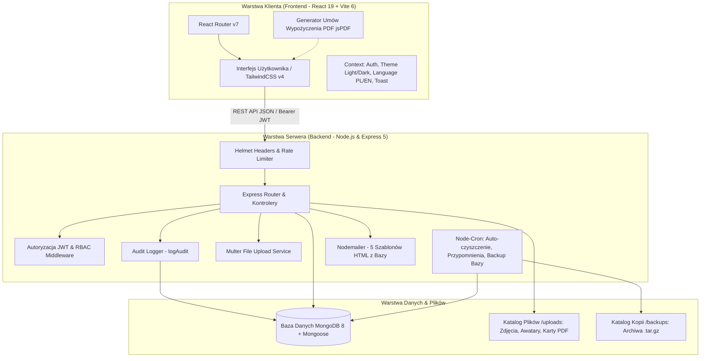
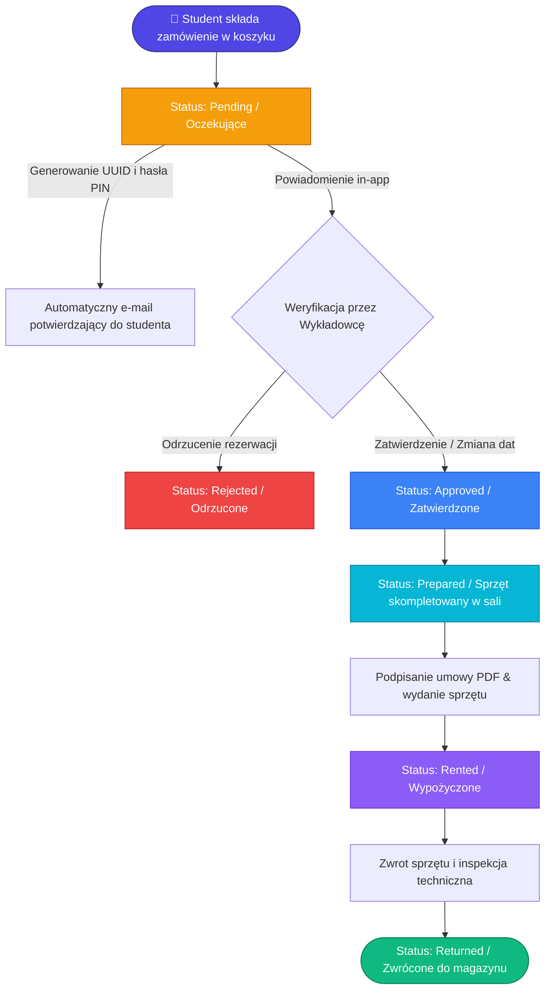

# 🔬 IoT Lab — Laboratory Inventory & Reservation System
### System Zarządzania Inwentarzem i Rezerwacją Sprzętu Laboratoryjnego

[](https://react.dev/)
[](https://vitejs.dev/)
[](https://tailwindcss.com/)
[](https://nodejs.org/)
[](https://expressjs.com/)
[](https://www.mongodb.com/)
[](https://helmetjs.github.io/)
[](https://put.poznan.pl/)

> 🎓 **Projekt zrealizowany w ramach pracy inżynierskiej na Politechnice Poznańskiej (PUT)**  
> *Developed as an Engineering Thesis at Poznań University of Technology.*

---

## ⚡ Szybki Start / Quick Start (3 Minuty)

Komendy dla terminala **PowerShell** (Windows) lub **Bash** (Linux/macOS):

```bash
# 1. Klonowanie repozytorium / Clone repo
git clone https://github.com/kkamilll/IoTLab.git
cd IoTLab

# 2. Skopiowanie plików konfiguracyjnych / Copy env templates
cp .env.example .env
cp frontend/.env.example frontend/.env

# 3. Instalacja zależności backendu i zasilenie bazy danych danymi testowymi
npm install
npm run db:seed    # Tworzy konta, obiekty, zamówienia, szablony i karuzelę

# 4. Instalacja zależności frontendu
cd frontend
npm install
cd ..
```

### Uruchomienie Serwerów Developerskich (2 osobne terminale):

```bash
# Terminal 1 — Serwer Backend REST API (port 3500, z katalogu głównego IoTLab):
npm run dev

# Terminal 2 — Serwer Frontend Vite (port 5173, z podkatalogu frontend):
cd frontend
npm run dev
```

Aplikacja jest dostępna pod adresami:  
👉 **Frontend (Klient & Panel):** [http://localhost:5173](http://localhost:5173)  
👉 **Backend (REST API):** [http://localhost:3500](http://localhost:3500)

---

## 📑 Spis Treści / Table of Contents

- [🇵🇱 Opis Systemu (Polski)](#-opis-systemu-w-języku-polskim)
- [🇬🇧 System Overview (English)](#-system-overview)
- [🏗️ Architektura Systemu](#️-architektura-systemu)
- [✨ Kluczowe Funkcjonalności & Moduły](#-kluczowe-funkcjonalności--moduły)
  - [1. Sklep Gościa & Wypożyczenia Bez Konta](#1-sklep-gościa--rezerwacje-bez-konta)
  - [2. Panel Zamówień & Kalendarz Osi Czasu](#2-panel-zamówień--kalendarz-osi-czasu)
  - [3. Uprawnienia Ról (Administrator vs Wykładowca)](#3-uprawnienia-ról-administrator-vs-wykładowca)
  - [4. Bezpieczeństwo & Ochrona Przed Atakami](#4-bezpieczeństwo--ochrona-przed-atakami)
  - [5. Dziennik Audytu & Historia Aktywności (Audit Log)](#5-dziennik-audytu--historia-aktywności-audit-log)
  - [6. Automatyczny Backup Bazy Danych](#6-automatyczny-backup-bazy-danych)
  - [7. Centrum Powiadomień z Auto-czyszczeniem](#7-centrum-powiadomień-z-auto-czyszczeniem)
  - [8. Edytowalne Szablony E-mail z Podglądem Na Żywo](#8-edytowalne-szablony-e-mail-z-podglądem-na-żywo)
  - [9. Karuzela / Slider & Tablica Ogłoszeń](#9-karuzela--slider--tablica-ogłoszeń)
  - [10. Nowoczesny Widok Profilu & Tryb Ciemny](#10-nowoczesny-widok-profilu--tryb-ciemny)
- [👥 Matryca Uprawnień (RBAC)](#-matryca-uprawnień-rbac)
- [🔄 Cykl Życia Zamówienia (Workflow)](#-cykl-życia-zamówienia-workflow)
- [💻 Stos Technologiczny](#-stos-technologiczny)
- [📁 Struktura Katalogów Projektu](#-struktura-katalogów-projektu)
- [🚀 Szczegółowa Konfiguracja Środowiska](#-szczegółowa-konfiguracja-środowiska)
- [🔑 Dane Kont Testowych](#-dane-kont-testowych)
- [📡 Dokumentacja Endpointów REST API](#-dokumentacja-endpointów-rest-api)
- [🗺️ Trasy Aplikacji (Routing)](#️-trasy-aplikacji-routing)
- [📜 Skrypty NPM](#-skrypty-npm)
- [❓ FAQ & Rozwiązywanie Problemów](#-faq--rozwiązywanie-problemów)
- [📄 Licencja i Informacje Akademickie](#-licencja-i-informacje-akademickie)

---

## 🇵🇱 Opis Systemu (W Języku Polskim)

**IoTLab** to kompleksowa platforma internetowa wspomagająca zarządzanie inwentarzem sprzętowym, rezerwacjami, wydawaniem oraz ewidencją aparatury elektronicznej i mikrokontrolerów w laboratoriach uczelnianych (np. Politechniki Poznańskiej).

Aplikacja rozwiązuje kluczowe problemy uczelnianych wypożyczalni:
1. **Dla studentów i gości:** Umożliwia wygodne przeglądanie sprzętu, koszykowe składanie rezerwacji na wybrane dni (`DD/MM/YYYY`) bez konieczności zakładania konta, natychmiastowe śledzenie stanu zamówienia za pomocą unikalnego kodu UUID i kodu PIN oraz negocjowanie terminów odbioru/zwrotu.
2. **Dla wykładowców i opiekunów sal:** Prezentuje sprzęt i zamówienia przypisane ściśle do ich sal laboratoryjnych (`labRooms`). Pozwala weryfikować dostępność w interaktywnym kalendarzu terminów, procesować rezerwacje krok po kroku oraz generować umowy wypożyczenia w formacie PDF jednym kliknięciem.
3. **Dla administratorów:** Daje pełną kontrolę nad globalnym stanem inwentarza, użytkownikami, uprawnieniami, salami, szablonami powiadomień e-mail, sliderem, tablicą ogłoszeń, audytem aktywności oraz automatycznymi kopiami zapasowymi bazy.

---

## 🇬🇧 System Overview

**IoTLab** is an end-to-end laboratory inventory management and hardware reservation platform designed to streamline the lifecycle of electronic equipment, development kits (Arduino, Raspberry Pi, ESP32, STM32, sensors, actuators, bench tools) across university facilities.

- **Students & Guests:** Cart checkout without mandatory account registration, day-based calendar date reservations (`DD/MM/YYYY`), real-time private order tracking via UUID & secret PIN, and schedule negotiation.
- **Academic Staff & Faculty:** Lab room inventory segregation, interactive timeline calendar preventing double-booking, safe status transitions, and automated PDF rental agreements.
- **Administrators:** Global management of categories, components, users, roles, email templates with live visual sandbox, announcement boards, audit logging, automatic database backups, and carousel slider media.

---

## 🏗️ Architektura Systemu



---

## ✨ Kluczowe Funkcjonalności & Moduły

### 1. Sklep Gościa & Rezerwacje Bez Konta
- **Katalog sprzętu:** Filtrowanie po kategoriach, dostępności, parametrach technicznych i opiekunie.
- **Koszyk 2-krokowy:** Wybór przedziału dat rezerwacji (`DD/MM/YYYY`), zabezpieczenie kodem Captcha, dane kontaktowe.
- **Prywatny tracker zamówienia:** Unikalny link `http://localhost:5173/orderPreview/:uuid` zabezpieczony wygenerowanym hasłem PIN wysyłanym w e-mailu.
- **Negocjacja terminu:** Klient może zaakceptować lub odrzucić alternatywny termin zaproponowany przez wykładowcę.

### 2. Panel Zamówień & Kalendarz Osi Czasu
- **Grupowanie zamówień (`OrderGroupCard`):** Zamówienia pogrupowane według klientów, terminów i sal laboratoryjnych.
- **Dedykowany modal procesowania (`Procesuj`):** Bezpieczne przejścia stanów (Zatwierdź, Przygotuj, Wypożycz z generowaniem umowy PDF, Zwróć, Odrzuć).
- **Interaktywny kalendarz wypożyczeń (`BigCalendarModal`):** Wizualny podgląd obłożenia sprzętu eliminujący kolizje rezerwacji.
- **Generowanie umowy PDF:** Jeden klik tworzy gotową do podpisu umowę wypożyczenia sprzętu ze specyfikacją, danymi wypożyczającego i regulaminem.

### 3. Uprawnienia Ról (Administrator vs Wykładowca)
- **Izolacja sal wykładowców:** Wykładowca po zalogowaniu widzi wyłącznie zamówienia i sprzęt przypisany do jego sal laboratoryjnych (`labRooms`).
- **Globalny nadzór administratora:** Administrator posiada pełny dostęp do wszystkich sal, zasobów i konfiguracji systemu.

### 4. Bezpieczeństwo & Ochrona Przed Atakami
- **Ochrona przed brute-force (`express-rate-limit`):** Krytyczne punkty uwierzytelniania (`/auth/login`, `/auth/forgot-password`, `/auth/reset-password`) są zabezpieczone limitem maksymalnie 5 prób na 15 minut z danego adresu IP.
- **Nagłówki bezpieczeństwa HTTP (`helmet`):** Zabezpieczenie przed atakami XSS, clickjackingiem, MIME-sniffingiem i wstrzykiwaniem obcych skryptów.
- **Polityka silnych haseł:** Wymóg min. 8 znaków, co najmniej jednej wielkiej litery i co najmniej jednej cyfry, weryfikowany synchronicznie na backendzie (`passwordValidator.js`) i w interfejsie użytkownika.
- **Szyfrowanie haseł:** Bezpieczne hashowanie algorytmem `bcrypt` z generowaną solą.

### 5. Dziennik Audytu & Historia Aktywności (Audit Log)
- **Kolekcja `AuditLog` w MongoDB:** Każda kluczowa zmiana w systemie jest automatycznie rejestrowana w bazie danych.
- **Szczegółowy ślad rewizyjny:** Zapisywane są: identyfikator użytkownika dokonującego zmiany, rola, akcja (np. `ORDER_STATUS_CHANGED`, `STOCK_UPDATED`, `TEMPLATE_UPDATED`, `USER_CREATED`), typ i ID modyfikowanego obiektu, szczegóły w formacie JSON oraz adres IP klienta.

### 6. Automatyczny Backup Bazy Danych
- **Cykliczne zrzuty (`backupService.js`):** Zadanie w tle (`node-cron`) uruchamiane codziennie o godzinie 02:00 w nocy wykonuje pełny zrzut bazy MongoDB za pomocą `mongodump` ze skompresowanym archiwum `.gz`.
- **Automatyczna retencja kopii:** Skrypt weryfikuje zawartość katalogu `backups/` i automatycznie usuwa archiwa starsze niż 30 dni, optymalizując przestrzeń dyskową serwera.

### 7. Centrum Powiadomień z Auto-czyszczeniem
- **Top 4 Karty KPI:** Wszystkie powiadomienia, Nieprzeczytane, Nowe zamówienia, Systemowe.
- **Automatyczne usuwanie przeczytanych powiadomień:** Zadanie w tle (`node-cron`) automatycznie usuwa przeczytane powiadomienia starsze niż 7 dni.
- **Błyskawiczne akcje:** „Oznacz wszystkie jako przeczytane” oraz „Usuń przeczytane”.

### 8. Edytowalne Szablony E-mail z Podglądem Na Żywo
- **Obsługa 5 kluczowych szablonów w bazie danych:**
  - `newOrder` – potwierdzenie złożenia zamówienia (z linkiem i kodem PIN).
  - `updateOrder` – informacja o zmianie statusu wypożyczenia.
  - `resetPassword` – jednorazowy 6-cyfrowy kod OTP do resetu hasła.
  - `returnReminder` – automatyczne przypomnienie o zbliżającym się terminie zwrotu sprzętu.
  - `overdueAlert` – ponaglenie w przypadku przekroczenia terminu wypożyczenia.
- **Interaktywny modal podglądu (Live Preview Modal):**
  - Wizualna symulacja nagłówków klienta pocztowego (*Od, Do, Temat*).
  - Prawdziwa wyrenderowana ramka e-mail IoTLab (`#4f46e5`) z podstawionymi danymi testowymi (`Jan Kowalski`, `#ORD-2026-98421`, link, kod `849 201`).
  - Zakładki: Podgląd wizualny, Kod HTML, Zestawienie zmiennych.
- **Kompozytor ze split-view:** Podgląd na żywo podczas pisania, przycisk „Wczytaj szablon wzorcowy”, klikalne pastylki wstawiania zmiennych oraz walidator wymaganych placeholderów.
- **Ochrona szablonów domyślnych:** Zabezpieczenie przed przypadkowym usunięciem szablonu domyślnego.

### 9. Karuzela / Slider & Tablica Ogłoszeń
- **Slider na stronie głównej:** Drag & drop zmiana kolejności slajdów, walidacja minimalnych wymiarów (min. 800×600 px), linki docelowe i modal powiększenia lightbox.
- **Ogłoszenia i Notatki:** Publikowanie ważnych komunikatów laboratoryjnych (np. godziny otwarcia, przerwa serwisowa) widocznych na stronie głównej z oznaczeniem ważności.

### 10. Nowoczesny Widok Profilu & Tryb Ciemny
- **Pełny Dark Mode:** Zintegrowany przełącznik motywu (jasny / ciemny) zapamiętywany w pamięci przeglądarki i zsynchronizowany na wszystkich stronach, modalach i formularzach.
- **Karty profilowe ułożone jedno pod drugim (`max-w-4xl mx-auto`):**
  1. *Wizytówka profilowa (Hero)* – duży awatar, status online, odznaka roli i licznik sal.
  2. *Dane osobowe i logowanie* – imię, nazwisko, e-mail, opis uprawnień.
  3. *Zdjęcie profilowe* – uploader z natychmiastowym podglądem i usuwaniem zdjęcia.
  4. *Bezpieczeństwo i hasło* – szyfrowanie bcrypt, walidator siły hasła i formularz zmiany hasła.
  5. *Pokoje laboratoryjne* – interaktywny edytor przypisanych sal laboratoryjnych.

---

## 👥 Matryca Uprawnień (RBAC)

| Funkcjonalność | Student / Gość | Wykładowca (Opiekun Sali) | Administrator |
| :--- | :---: | :---: | :---: |
| Przeglądanie publicznego katalogu sprzętu | ✅ | ✅ | ✅ |
| Składanie rezerwacji przez koszyk (bez logowania) | ✅ | ✅ | ✅ |
| Śledzenie rezerwacji przez link UUID + kod PIN | ✅ | ✅ | ✅ |
| Zarządzanie sprzętem w **przypisanych salach** | ❌ | ✅ | ✅ |
| Procesowanie zamówień w **przypisanych salach** | ❌ | ✅ | ✅ |
| Otrzymywanie powiadomień o nowych rezerwacjach | ❌ | ✅ | ✅ |
| Generowanie umów wypożyczenia w formacie PDF | ❌ | ✅ | ✅ |
| Podgląd kalendarza terminów i osi czasu | ❌ | ✅ | ✅ |
| Dostęp do sprzętu i zamówień **wszystkich sal** | ❌ | ❌ | ✅ |
| Zarządzanie kontami użytkowników i rolami | ❌ | ❌ | ✅ |
| Zarządzanie kategoriami i zestawami komponentów | ❌ | ❌ | ✅ |
| Edycja szablonów wiadomości e-mail (5 typów) | ❌ | ❌ | ✅ |
| Zarządzanie slajdami karuzeli głównej | ❌ | ❌ | ✅ |
| Podgląd logów audytowych (Audit Log) | ❌ | ❌ | ✅ |

---

## 🔄 Cykl Życia Zamówienia (Workflow)



---

## 💻 Stos Technologiczny

### Frontend
- **Framework:** [React 19](https://react.dev/) + [Vite 6](https://vitejs.dev/)
- **Stylowanie:** [TailwindCSS v4](https://tailwindcss.com/) + CSS Design Tokens
- **Tryb Ciemny:** `ThemeContext` (przełączanie motywów Light/Dark z persystencją w `localStorage`)
- **Routing:** [React Router v7](https://reactrouter.com/)
- **Ikony:** [Lucide React](https://lucide.dev/)
- **Kalendarz:** [React Big Calendar](https://jquense.github.io/react-big-calendar/) + [Date-fns](https://date-fns.org/)
- **Drag & Drop:** `@dnd-kit/core`, `@dnd-kit/sortable`
- **Generowanie PDF:** [jsPDF](https://github.com/parallax/jsPDF) + `jspdf-autotable`
- **Wielojęzyczność:** Dedykowany kontekst i18n (`pl.json`, `en.json`)

### Backend
- **Środowisko:** [Node.js 18+](https://nodejs.org/) (ES Modules)
- **Framework REST API:** [Express 5](https://expressjs.com/)
- **Baza Danych:** [MongoDB](https://www.mongodb.com/) z ODM [Mongoose 8](https://mongoosejs.com/)
- **Bezpieczeństwo:**
  - `helmet` — bezpieczne nagłówki HTTP chroniące przed atakami XSS i clickjackingiem.
  - `express-rate-limit` — limitowanie żądań do endpointów logowania i resetu hasła (ochrona przed brute-force).
  - `passwordValidator.js` — walidacja złożoności haseł (min. 8 znaków, cyfra, wielka litera).
  - `bcrypt` — bezpieczne hashowanie haseł.
  - `jsonwebtoken` — bezstanowe tokeny sesyjne JWT.
- **Audyt Zmian:** Model `AuditLog` rejestrujący kluczowe operacje systemowe.
- **Kopie Zapasowe:** `backupService.js` z cyklicznym zrzutem `mongodump` (`.gz`) i retencją 30 dni.
- **Wysyłka Poczty:** [Nodemailer](https://nodemailer.com/) (SMTP / Gmail App Passwords) z 5 szablonami z bazy danych.
- **Obsługa Plików:** `multer` (katalog `/uploads`)
- **Zadania Cykliczne:** `node-cron` (auto-czyszczenie powiadomień, przypomnienia o zwrotach, backup bazy)

---

## 📁 Struktura Katalogów Projektu

> [!IMPORTANT]
> **Struktura repozytorium:**  
> - **Katalog główny (`/`):** Pliki konfiguracyjne, środowiskowe, skrypty bazy danych oraz zależności serwera Express (`package.json`).
> - **Katalog frontendu (`/frontend`):** Samodzielna aplikacja React + Vite z własnym `package.json`.
> - **Katalog backendu (`/backend`):** Kontrolery, modele Mongoose, middleware, serwisy pocztowe i routery.
> - **Katalog kopii (`/backups`):** Automatycznie tworzone archiwa zrzutów bazy MongoDB.

```plaintext
IoTLab/
├── .env                      # Zmienne środowiskowe backendu (PORT, MONGO_URI, JWT_SECRET, SMTP)
├── .env.example              # Szablon zmiennych backendu
├── package.json              # Zależności BACKENDU i skrypty bazodanowe
├── README.md                 # Dokumentacja projektu
│
├── backups/                  # Automatyczne archiwa bazy danych mongodump (.gz)
│
├── backend/                  # Kod źródłowy API (Node.js & Express)
│   ├── config/               # Połączenie z MongoDB (db.js)
│   ├── controllers/          # Logika biznesowa (Order, Product, User, Category, Template, etc.)
│   ├── errors/               # Niestandardowa hierarchia błędów HTTP (CustomErrors.js)
│   ├── middleware/           # Autoryzacja JWT, RBAC, obsługa uploadu plików Multer
│   ├── models/               # Schematy Mongoose (User, Product, Order, Template, Note, Material, AuditLog)
│   ├── routes/               # Endpointy Express REST API
│   ├── services/             # Serwisy systemowe (backupService.js)
│   ├── utils/                # Wysyłka e-maili, auditLogger, passwordValidator, mockData, captche
│   ├── init.js               # Skrypt czyszczący bazę (inicjalizacja konta admina i szablonów)
│   ├── seed.js               # Skrypt zasilający pełnymi danymi demonstracyjnymi
│   └── server.js             # Główny punkt wejścia serwera API (port 3500) z Helmet i RateLimiter
│
├── frontend/                 # Kod źródłowy klienta (React 19 + Vite 6)
│   ├── .env                  # Zmienne frontendu (VITE_API_IP, VITE_API_PORT, VITE_API_BASE_URL)
│   ├── .env.example          # Szablon zmiennych frontendu
│   ├── src/
│   │   ├── api/              # Klient Axios z automatyczną obsługą nagłówków JWT
│   │   ├── components/       # Komponenty wielokrotnego użytku (layout, orders, modals)
│   │   ├── context/          # Dostawcy stanu (AuthContext, ThemeContext, LanguageContext, ToastContext)
│   │   ├── locales/          # Słowniki tłumaczeń (pl.json, en.json)
│   │   ├── pages/            # Widoki aplikacji (Orders, Products, Users, Templates, Profile, etc.)
│   │   ├── utils/            # Generatory PDF, formatowania dat, walidatory haseł
│   │   ├── App.jsx           # Konfiguracja routingu React Router v7
│   │   └── main.jsx          # Punkt wejścia aplikacji React
│   ├── public/               # Zasoby statyczne
│   └── package.json          # Zależności FRONTENDU
│
└── uploads/                  # Przechowywalnia przesłanych zdjęć sprzętu i awatarów
```

---

## 🚀 Szczegółowa Konfiguracja Środowiska

### Wymagania wstępne:
1. **Node.js**: Wersja `v18.0.0` lub wyższa ([Pobierz Node.js](https://nodejs.org/)).
2. **MongoDB**: Lokalna instancja MongoDB działająca na porcie `27017` (np. jako usługa Windows) lub klaster [MongoDB Atlas](https://www.mongodb.com/cloud/atlas).
3. **MongoDB Database Tools** (opcjonalnie dla kopii zapasowych): Narzędzie `mongodump` zainstalowane w ścieżce systemowej dla automatycznego backupu.
4. **NPM**: Domyślny menedżer pakietów Node.js.

### 1. Konfiguracja Backendu (`/.env`):
```env
PORT=3500
MONGO_URI=mongodb://127.0.0.1:27017/iotlab_db
JWT_SECRET=super_tajny_klucz_jwt_iotlab_2026

# Poczta wychodząca Nodemailer (opcjonalnie do realnej wysyłki e-maili):
SMTP_HOST=smtp.gmail.com
SMTP_SERVICE=gmail
SMTP_PORT=587
SMTP_MAIL=twoj_email@gmail.com
SMTP_PASSWORD=twoje_haslo_aplikacji_gmail
```

### 2. Konfiguracja Frontendu (`/frontend/.env`):
```env
VITE_API_IP=http://localhost:
VITE_API_PORT=3500
VITE_API_POSTFIX=
VITE_API_BASE_URL=http://localhost:3500
```

### 3. Zasilenie Bazy Danych Danymi Testowymi:
W głównym katalogu `IoTLab` uruchom:
```bash
npm run db:seed
```
> Komenda utworzy konta użytkowników, kategorie, sprzęt laboratoryjny, zamówienia w różnych stanach, 5 szablonów wiadomości e-mail oraz slajdy karuzeli.

---

## 🔑 Dane Kont Testowych

Po wykonaniu `npm run db:seed` w bazie dostępne są następujące konta:

| Rola w systemie | Adres E-mail | Hasło startowe | Przypisane Sale Laboratoryjne | Uprawnienia |
| :--- | :--- | :--- | :--- | :--- |
| **Administrator** | `admin@gmail.com` | `admin` | Sala 101, 102, 201, 301 | **Pełny dostęp do całego systemu i audytu** |
| **Wykładowca 1** | `lecturer1@gmail.com` | `password` | Sala 101, 102 | Tylko zamówienia i sprzęt z sal 101, 102 |
| **Wykładowca 2** | `lecturer2@gmail.com` | `password` | Sala 201 | Tylko zamówienia i sprzęt z sali 201 |
| **Wykładowca 3** | `lecturer3@gmail.com` | `password` | Sala 301 | Tylko zamówienia i sprzęt z sali 301 |

> [!NOTE]
> Przy zmianie hasła w profilu lub przez procedurę resetu hasła obowiązuje **polityka bezpieczeństwa**: hasło musi mieć min. 8 znaków, co najmniej jedną wielką literę oraz co najmniej jedną cyfrę (np. `Admin2026!`).

---

## 📡 Dokumentacja Endpointów REST API

Główny adres serwera: `http://localhost:3500`

| Moduł | Metoda | Ścieżka | Wymagana Rola / Zabezpieczenie | Opis |
| :--- | :---: | :--- | :---: | :--- |
| **Auth** | `POST` | `/auth/login` | Publiczny (Rate Limiter: max 5 / 15 min) | Logowanie i generowanie tokena JWT |
| | `POST` | `/auth/forgot-password` | Publiczny (Rate Limiter: max 5 / 15 min) | Generowanie 6-cyfrowego kodu weryfikacyjnego OTP |
| | `POST` | `/auth/reset-password` | Publiczny (Rate Limiter: max 5 / 15 min) | Reset hasła kodem OTP (walidacja siły hasła) |
| **Orders** | `POST` | `/orders/create` | Publiczny | Składanie nowej rezerwacji przez gościa w koszyku |
| | `GET` | `/orders/customerOrder/:orderUUID`| Publiczny | Pobieranie danych zamówienia dla studenta |
| | `POST` | `/orders/customerUpdate/:orderId` | Publiczny (kod PIN)| Akceptacja/odrzucenie negocjowanego terminu |
| | `GET` | `/orders` | Wykładowca / Admin | Pobieranie zamówień (filtrowane salami wykładowcy) |
| | `PUT` | `/orders/updateOrder/:orderId` | Wykładowca / Admin | Zmiana statusu rezerwacji i terminów (rejestrowana w AuditLog) |
| | `GET` | `/orders/stats` | Wykładowca / Admin | Statystyki i metryki zamówień |
| | `POST` | `/orders/download-pdf` | Wykładowca / Admin | Pobranie umowy wypożyczenia PDF |
| | `DELETE`| `/orders/:orderId` | Administrator | Trwałe usunięcie rekordu zamówienia |
| **Products** | `GET` | `/products/public` | Publiczny | Sprzęt dostępny do rezerwacji dla gości |
| | `POST` | `/products/available` | Publiczny | Obliczanie wolnych sztuk w wybranym przedziale dat |
| | `GET` | `/products/private` | Wykładowca / Admin | Pełna lista inwentarza (filtrowana salami) |
| | `POST` | `/products/create` | Wykładowca / Admin | Dodanie nowego obiektu sprzętowego |
| | `PUT` | `/products/:productId` | Wykładowca / Admin | Aktualizacja parametrów i stanów magazynowych |
| | `DELETE`| `/products/:productId` | Wykładowca / Admin | Usunięcie sprzętu z ewidencji |
| **Users** | `GET` | `/users/profile` | Uwierzytelniony | Pobranie danych profilu zalogowanego użytkownika |
| | `PUT` | `/users/profile` | Uwierzytelniony | Aktualizacja profilu, sal, zdjęcia i hasła |
| | `GET` | `/users` | Administrator | Pobranie listy użytkowników kadry dydaktycznej |
| | `POST` | `/users/create` | Administrator | Rejestracja nowego wykładowcy lub administratora |
| | `PUT` | `/users/:userId` | Administrator | Modyfikacja konta i przypisania sal |
| | `DELETE`| `/users/:userId` | Administrator | Usunięcie konta użytkownika |
| **Templates** | `GET` | `/templates` | Administrator | Lista 5 szablonów e-mail (`newOrder`, `updateOrder`, etc.) |
| | `GET` | `/templates/names` | Administrator | Lista zarejestrowanych typów szablonów systemowych |
| | `GET` | `/templates/:templateId` | Administrator | Szczegóły szablonu e-mail |
| | `POST` | `/templates/create` | Administrator | Utworzenie nowego szablonu |
| | `PUT` | `/templates/update/:templateId` | Administrator | Zapisanie zmian w szablonie (rejestrowane w AuditLog) |
| | `DELETE`| `/templates/delete/:templateId` | Administrator | Usunięcie szablonu (z blokadą domyślnych) |
| **Notifications** | `GET` | `/notifications` | Wykładowca / Admin | Lista powiadomień użytkownika |
| | `PATCH` | `/notifications/read-all` | Wykładowca / Admin | Oznaczenie wszystkich jako przeczytane |
| | `DELETE`| `/notifications/read` | Wykładowca / Admin | Usunięcie przeczytanych powiadomień |
| **Notes** | `GET` | `/notes` | Publiczny | Lista ogłoszeń na stronie głównej |
| | `POST` | `/notes/create` | Wykładowca / Admin | Publikacja ogłoszenia laboratoryjnego |
| | `PUT` | `/notes/:noteId` | Wykładowca / Admin | Edycja ogłoszenia |
| | `DELETE`| `/notes/:noteId` | Wykładowca / Admin | Usunięcie ogłoszenia |
| **Materials** | `GET` | `/materials` | Publiczny | Lista slajdów karuzeli głównej |
| | `POST` | `/materials` | Administrator | Przesłanie nowego zdjęcia slajdu |
| | `PATCH` | `/materials/reorder` | Administrator | Zapisanie nowej kolejności slajdów |
| | `DELETE`| `/materials/:id` | Administrator | Usunięcie slajdu z karuzeli |

---

## 🗺️ Trasy Aplikacji (Routing)

### Strefa Publiczna (Studenci & Goście):
- `/` — Strona główna z karuzelą slajdów, ogłoszeniami i wyszukiwarką zamówień.
- `/mainguest` — Portal kafelkowy wyboru kategorii urządzeń.
- `/guest-products/:menuCategory?` — Katalog aparatury z filtrami i wysuwanym koszykiem.
- `/cart` — Dwuetapowa rezerwacja koszykowa z wyborem dat i zabezpieczeniem Captcha.
- `/orderPreview/:orderUUID` — Panel śledzenia zamówienia dla studenta (dostęp kodem PIN).
- `/login` — Bramka logowania dla kadry laboratoryjnej (z zabezpieczeniem rate-limit).
- `/forgot-password` — Procedura odzyskiwania hasła za pomocą jednorazowego kodu OTP.

### Strefa Administracyjna (`/admin-dashboard`):
- `/admin-dashboard` — Pulpit główny, analityka wypożyczeń i statystyki.
- `/admin-dashboard/orders` — Tabela zamówień z podziałem na statusy i interaktywnym kalendarzem.
- `/admin-dashboard/products` — Ewidencja sprzętu laboratoryjnego i stanów magazynowych.
- `/admin-dashboard/users` *(Tylko Admin)* — Zarządzanie kontami użytkowników i przypisaniami sal.
- `/admin-dashboard/notifications` — Centrum powiadomień z auto-czyszczeniem starszych wpisów.
- `/admin-dashboard/notes` — Tablica ogłoszeń laboratoryjnych publikowanych na stronie startowej.
- `/admin-dashboard/slider` *(Tylko Admin)* — Menedżer karuzeli zdjęć z funkcją przeciągania (drag & drop).
- `/admin-dashboard/templates` *(Tylko Admin)* — Edytor szablonów e-mail z podglądem na żywo, walidacją i 5 typami powiadomień.
- `/admin-dashboard/profile` — Mój profil (dane osobowe, zmiana hasła z walidacją siły, sale i awatar).

---

## 📜 Skrypty NPM

### Katalog główny (`/`):
| Skrypt | Komenda | Działanie |
| :--- | :--- | :--- |
| `npm run dev` | `nodemon backend/server.js` | Uruchamia serwer API Express z automatycznym przeładowaniem. |
| `npm run db:seed` | `node backend/seed.js` | Czyści i zasila bazę pełnymi danymi demonstracyjnymi. |
| `npm run db:init` | `node backend/init.js` | Inicjalizuje czystą bazę z kontem administratora i szablonami. |
| `npm run db:start` | `mongod --dbpath .mongo_data` | Ręczne uruchomienie bazy MongoDB w katalogu lokalnym. |

### Katalog frontendu (`/frontend`):
| Skrypt | Komenda | Działanie |
| :--- | :--- | :--- |
| `npm run dev` | `vite --host` | Uruchamia serwer developerski Vite (`http://localhost:5173`). |
| `npm run build` | `vite build` | Buduje zoptymalizowaną paczkę produkcyjną w `frontend/dist/`. |
| `npm run preview` | `vite preview` | Lokalny podgląd zbudowanej paczki produkcyjnej. |
| `npm run lint` | `eslint .` | Uruchamia analizę statyczną kodu ESLint. |

---

## ❓ FAQ & Rozwiązywanie Problemów

<details>
<summary><b>1. Sprzęt lub zamówienia nie wyświetlają się w aplikacji?</b></summary>

- Upewnij się, że usługa MongoDB działa (`Get-Service -Name MongoDB` w PowerShell).
- Wykonaj `npm run db:seed` w głównym katalogu projektu, aby załadować przykładowe dane.
- Upewnij się, że oba pliki `.env` (w root i w `frontend/.env`) zostały utworzone.
</details>

<details>
<summary><b>2. Wykładowca nie widzi niektórych zamówień w panelu?</b></summary>

- Jest to zamierzone zachowanie systemu kontroli dostępu: wykładowca ma wgląd wyłącznie w sprzęt i zamówienia przypisane do sal laboratoryjnych (`labRooms`), do których posiada uprawnienia.
- Zaloguj się na konto administratora (`admin@gmail.com` / `admin`), aby widzieć wszystkie zamówienia ze wszystkich sal.
</details>

<details>
<summary><b>3. Komunikat o zbyt wielu próbach logowania (Rate Limit)?</b></summary>

- System chroni endpointy `/auth/login`, `/auth/forgot-password` oraz `/auth/reset-password` limitem 5 zapytań na 15 minut na adres IP.
- Odczekaj 15 minut lub zrestartuj serwer backendowy w trybie deweloperskim.
</details>

<details>
<summary><b>4. Błąd: 'vite' is not recognized as an internal or external command?</b></summary>

- Zależności frontendu nie zostały zainstalowane. Wejdź do katalogu `frontend` i wykonaj:
  ```bash
  cd frontend
  npm install
  ```
</details>

<details>
<summary><b>5. Jak skonfigurować wysyłanie prawdziwych e-maili?</b></summary>

- W pliku `.env` w katalogu głównym wpisz dane konta SMTP (np. Gmail):
  - `SMTP_MAIL=twoj_adres@gmail.com`
  - `SMTP_PASSWORD=twoje_haslo_aplikacji` *(generowane w ustawieniach konta Google -> Bezpieczeństwo -> Weryfikacja dwuetapowa -> Hasła aplikacji).*
</details>

---

## 📄 Licencja i Informacje Akademickie

Projekt przygotowany w ramach pracy inżynierskiej na **Politechnice Poznańskiej** (*Poznań University of Technology — PUT*).  
Wszelkie prawa zastrzeżone do celów edukacyjnych i badawczych.
